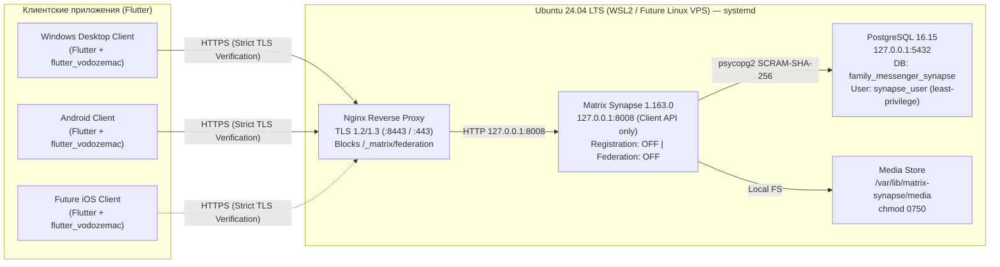

# Family Messenger — Архитектура системы и техническая оценка (Phase 0)

## 1. Обзор архитектуры (Zero-Docker Native Stack)

Система построена **полностью без использования Docker, Podman и контейнеризации**. Все серверные компоненты работают нативно под управлением `systemd` внутри **Ubuntu 24.04 LTS** (на этапе Phase 0 — в WSL2 на Windows 11 Pro; начиная с Phase 1/Production — на выделенном Linux VPS с идентичной конфигурацией).

---

## 2. Техническая оценка Reverse Proxy: Nginx vs Caddy

Перед выбором обратного прокси проведена оценка обоих вариантов для нативного развёртывания в Ubuntu 24.04 LTS:

| Критерий | Nginx (`1.24.0-2ubuntu7.18`) | Caddy (`2.6.2-6ubuntu0.24.04.3`) |
|---|---|---|
| Репозиторий Ubuntu 24.04 | `main` (официальная поддержка Canonical Security Team) | `universe` (более старая ветка 2.6.x в стандартном репо) |
| Гранулярная блокировка Matrix Federation | Нативный regex-блок `location ~ ^/_matrix/(federation\|key) { return 403; }` на уровне периметра | Поддерживается через `handle_path` / `respond` |
| Контроль локального Private PKI (Phase 0) | Прямое управление `ssl_certificate` / `ssl_certificate_key` без фоновой попытки установить собственный CA в системное хранилище | Caddy пытается запускать `caddy trust` с локальным промежуточным CA |
| Совместимость с портами Windows 11 + SEO Studio | Легко привязывается строго к `8443` без захвата порта `80` (занят `HTTP.sys` в Windows) и `8080` (занят SEO Studio) | По умолчанию пытается занять порт `80` для HTTP->HTTPS редиректа, если не отключить `auto_https` |
| Переход на VPS с Let's Encrypt | Стандартный `certbot --nginx` + systemd timer | Встроенный ACME |

**Вывод**: Для Phase 0 (WSL2 рядом с Windows `HTTP.sys` на порту 80 и проектом SEO Studio на портах 3000/8080) и предсказуемого периметра безопасности выбран и настроен **Nginx** из официального репозитория Ubuntu `main`.

---

## 3. Архитектура клиента (`family-messenger`)

Монорепозиторий разделён на три чистых уровня:
1. `packages/design_system` — авторская дизайн-система **Hearth & Nordic Linen** (светлая и тёмная темы, адаптивные токены отступов, типографика, компоненты без декоративных заглушек).
2. `packages/messenger_core` — ядро бизнес-логики и криптографии:
   - Обёртка над официальным **Matrix Dart SDK (`matrix: ^14.1.0`)**.
   - Нативная криптография Olm/Megolm через **Rust `vodozemac` (`flutter_vodozemac: ^0.8.1`)** — без самописных криптоалгоритмов.
   - Локальное хранилище истории сообщений и состояния синхронизации на базе SQLite (`MatrixSdkDatabase` + `sqflite_common_ffi` для Windows/Desktop и `sqflite` для Android/iOS).
   - Безопасное хранение сессии и ключей восстановления (`RecoveryKey` / SSSS / Cross-Signing + экспорт/импорт ключей Megolm).
   - Строгая проверка TLS-сертификатов через `SecurityContext` с доверенным корневым сертификатом `Family Messenger Test Root CA` (флаг `badCertificateCallback` **не используется**).
3. `apps/messenger` — кроссплатформенное приложение Flutter (Windows Desktop, Android, готовность к iOS) с адаптивным Master-Detail интерфейсом для десктопа/планшетов и однопанельной навигацией для смартфонов.

---

## 4. Расширяемость под будущие функции (Phase 1 — Phase 3)

Архитектура `messenger_core` и `Synapse` сразу закладывает фундамент для всех запланированных возможностей:
- **Личные и групповые переписки с E2EE по умолчанию**: включено на уровне сервера (`encryption_enabled_by_default_for_room_type: all`) и клиента (`m.room.encryption` с алгоритмом `m.megolm.v1.aes-sha2`).
- **Фото, видео, документы и голосовые сообщения**: Matrix Media Repository (`/var/lib/matrix-synapse/media`, лимит `50M`) + встроенное шифрование вложений (`encryptFile` / `decryptFile` в Matrix SDK).
- **Аудио- и видеозвонки (coturn + MatrixRTC / LiveKit)**:
  - В Matrix SDK `14.1.0` уже интегрирован `webrtc_interface: ^1.2.0` и `sdp_transform`.
  - На этапе VPS (Phase 2) рядом с Synapse разворачивается нативный `coturn` (STUN/TURN по `turn_uris` и `turn_shared_secret` в `homeserver.yaml`) и при необходимости SFU `lk-jwt-service` + `livekit-server` для групповых звонков MatrixRTC (MSC4143).
- **Реакции, ответы, пересылка, редактирование и удаление**: нативные события Matrix (`m.annotation`, `m.replace`, `m.room.redaction`, `m.relates_to`), уже поддерживаемые схемой БД `MatrixSdkDatabase`.
- **Поиск по переписке**: локальный полнотекстовый поиск по расшифрованному кешу `MatrixSdkDatabase` на устройстве.
- **Несколько устройств и восстановление доступа**: Cross-Signing + Online Key Backup (SSSS) + экспорт/импорт резервной копии ключей комнат с парольной защитой.
- **Семейные фотоальбомы и общий файловый раздел**: реализуются как специализированные зашифрованные Matrix Spaces (`m.space`) и типизированные комнаты-альбомы без изменения серверного бэкенда.
